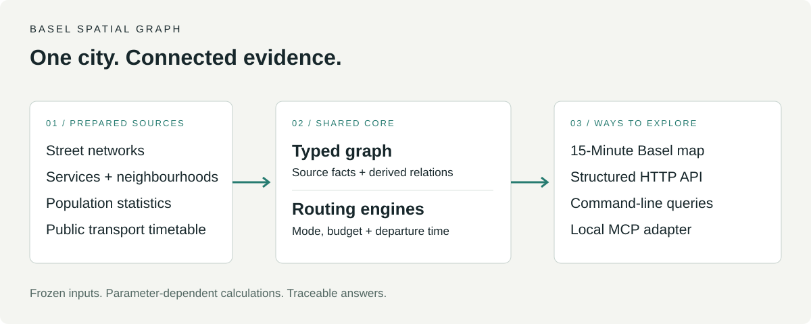

# Basel Spatial Graph

### Ask a city question. Follow the evidence.

Explore Basel's streets, services, neighbourhoods and public transport through one typed graph. Query it from a map, an HTTP API, a command line or a local MCP client—with sources and computation methods attached to the answers.

**[Quick start](#run-locally) · [Query API](basel-spatial-graph-v0/docs/QUERY_API.md) · [MCP](basel-spatial-graph-v0/docs/MCP.md) · [Data attribution](ATTRIBUTION.md)**



*Architecture overview, not a screenshot. The map is one client of the shared graph and routing core.*

> **Research prototype with a real, frozen dataset.** Sources were retrieved on **20 August 2026**. The shipped timetable ends on **12 December 2026**. Results describe that snapshot, not current city conditions.

## What can you ask?

| Question | What contributes to the answer |
|---|---|
| What can I reach within 15 minutes? | Street networks, service locations and the selected travel mode |
| How does walking compare with cycling or transit? | Separate network models; transit includes departure time and waiting |
| Which neighbourhoods combine many children with weaker service access? | Official population statistics, graph relations and routing calculations |
| Where did this number come from? | Source identifiers, retrieval metadata and method-specific provenance |

The reference application, **15-Minute Basel**, lets you choose a location, mode and time budget. The same core also supports structured queries and agent access.

## Run locally

Use **Python 3.10+** for a common starting point; the optional MCP adapter has additional dependencies.

```bash
git clone https://github.com/blackmath88/basel-spatial-graph.git
cd basel-spatial-graph/basel-spatial-graph-v0
python3 -m venv .venv
source .venv/bin/activate
python -m pip install -r requirements.txt
uvicorn app.main:app --reload --host 127.0.0.1
```

On Windows, activate with `.venv\Scripts\activate` instead. Open **http://127.0.0.1:8000** for the map or **http://127.0.0.1:8000/docs** for the API explorer.

The prepared data are committed: no import or refresh is needed. The browser map loads external map assets; API and CLI queries use the local snapshot.

In a second terminal with the same environment activated:

```bash
python -m app.spatial_graph.cli ask q6_children_underserved --table
```

This returns a neighbourhood table combining population, pharmacy access and transit stops. Consult the response's provenance before interpreting or comparing results.

## Three kinds of evidence

| Kind | Example | Interpretation |
|---|---|---|
| Source fact | Population figure from a cantonal dataset | Preserve the source and reference year |
| Derived relation | A service attached to a street-network node | Inspect the method and snapping quality |
| Request-time calculation | Travel time under a selected mode and budget | Depends on those parameters and the frozen inputs |

Request-time computation does **not** mean live data. Missing services, imperfect snapping and simplified travel models can change the apparent accessibility of a place.

## Know the boundaries

- Coverage centres on Basel-Stadt; one snapshot is not a time series or a multi-city comparison.
- Walking and cycling use simplified models. There is no step-free routing or opening-hours model.
- Transit uses a static timetable, without live delays or disruptions.
- Neighbourhood summaries use representative origins, not population-weighted household access.
- This is an exploratory model, not an official urban quality score or a journey-planning guarantee.

Read the [full limitations](basel-spatial-graph-v0/README.md#known-limitations) before using results for decisions.

## Documentation and contribution

| Task | Guide |
|---|---|
| Understand the graph | [Spatial graph](basel-spatial-graph-v0/docs/SPATIAL_GRAPH.md) |
| Query, group and aggregate | [Query reference](basel-spatial-graph-v0/docs/QUERY_API.md) |
| Connect an agent locally | [MCP setup](basel-spatial-graph-v0/docs/MCP.md) |
| Inspect modes, data and refresh procedures | [Full project guide](basel-spatial-graph-v0/README.md) |
| Make a change | [Contributing](CONTRIBUTING.md) |

Run `pytest` from `basel-spatial-graph-v0/` after installing the requirements. Optional preparation and MCP dependencies enable additional tests; report skips explicitly.

**License:** [MIT for code](LICENSE). Committed datasets retain their [upstream licenses and attribution](ATTRIBUTION.md).
